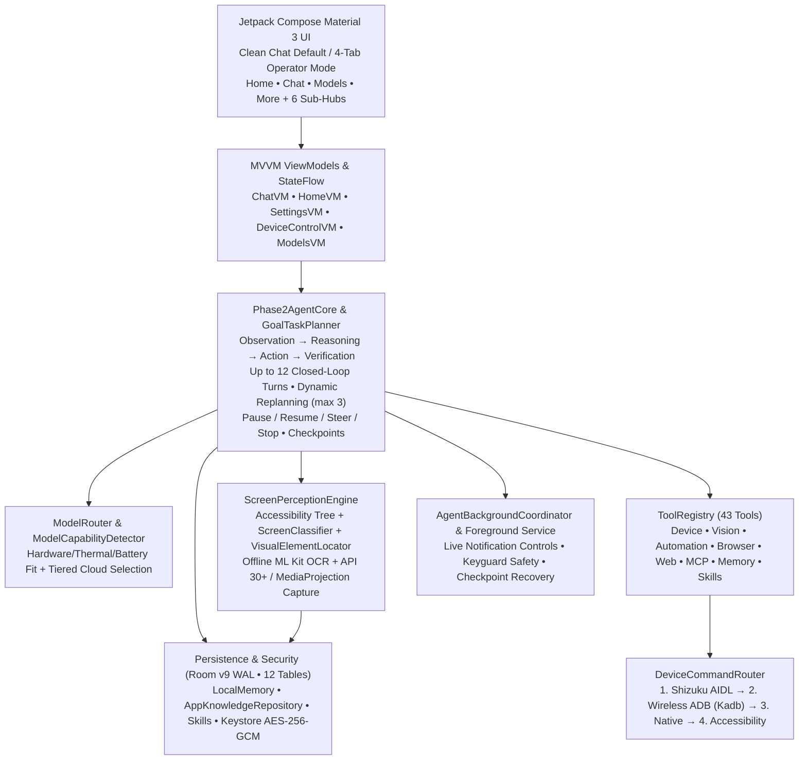

<div align="center">


<br />
<br />


# J.A.R.V.I.S

**Autonomous Local-First Android AI Agent**

*Goal-oriented multi-step planning, unified non-root phone control, offline vision & OCR, stateful browser automation, MCP tool interoperability, and on-device LiteRT-LM inference.*

<p>
  
  
  
  
  
  
  
</p>

[Architecture](docs/ARCHITECTURE.md) · [Build & Install](docs/BUILD_AND_INSTALL.md) · [Release Notes](docs/RELEASE_NOTES.md) · [Test Plan](docs/TEST_PLAN.md) · [Security](SECURITY.md) · [Contributing](CONTRIBUTING.md)

</div>

---

## Overview

**J.A.R.V.I.S** (`com.aistudio.jarvis.k8v4mz`) is an open-source, privacy-first autonomous Android AI agent engineered in **Kotlin** and **Jetpack Compose (Material 3)**. Designed to run locally on-device with **Google LiteRT-LM** and optionally route complex reasoning or vision turns to user-configured cloud providers (**Gemini**, **OpenAI-compatible**, **OpenRouter**, **Anthropic**), J.A.R.V.I.S bridges natural-language goals and real Android device execution without requiring root access.

### Core Engineering Principles
- **No Root Required:** Prioritizes official **Shizuku (`13.1.5`)** `UserService` IPC and pure-Kotlin **Wireless ADB (`Kadb 1.3.0`)**, seamlessly falling back to native Android APIs and opt-in **Accessibility Service** automation.
- **Observe → Reason → Act → Verify:** Runs a bounded 12-turn closed loop with screen state classification, stagnation/oscillation recovery, dynamic replanning (up to 3 replans per run), resumable checkpoints, and live Pause / Resume / Steer / Stop controls.
- **Security by Default:** Protects all credentials with **Android Keystore AES-256-GCM**, enforces **SSRF protection** (`PublicHttpSafetyGuard`) across web/browser requests and redirects, blocks automated control inside banking/authenticator/installer packages (`AppBlocklistPolicy`), and gates high-risk actions behind explicit user confirmation.
- **Honest Runtime Capabilities:** Never fakes unsupported model formats (`GGUF`, `.tflite`, `.task`, `.safetensors` are explicitly rejected as unsupported rather than mocked) and never fabricates telemetry or unavailable hardware permissions.

---

## Key Capabilities

| Pillar | Capabilities |
| :--- | :--- |
| **Autonomous Agent Core** | `GoalTaskPlanner` multi-step goal decomposition, `Phase2AgentCore` 12-turn closed loop, explicit `AgentExecutionPhase` state machine (`THINKING`, `OBSERVING`, `EXECUTING`, `VERIFYING`, `RECOVERING`, `PAUSED`, etc.), bounded replanning (max 3), mid-run user steering, Room `agent_checkpoints` pause/resume, and `AgentBackgroundCoordinator` foreground notification controls. |
| **Unified Phone Control (43 Tools)** | Priority-routed `DeviceCommandRouter` (`Shizuku AIDL → Wireless ADB → Native Android → Accessibility`), `AndroidAutomationEngine` (`wait_for_screen`, `locate_and_tap_visual`, `navigate_device`), semantic & coordinate gestures (`tap_ui_element`, `tap_coordinates`, `long_press_coordinates`, `swipe_screen`, `scroll_screen`, `input_ui_text`), and allowlisted privileged actions (`force_stop_app`, `trim_app_caches`). |
| **Screen Perception & Offline Vision** | `ScreenPerceptionEngine` combining DFS Accessibility tree compression (`ScreenTreeCompressor` with `[REDACTED_PASSWORD]` masking), `ScreenClassifier` (9 screen types), `VisualElementLocator`, offline **ML Kit OCR (`16.0.1`)**, API 30+ `AccessibilityService.takeScreenshot()`, Android 14+ `MediaProjectionForegroundService` fallback, and context-aware cloud screenshot gating. |
| **Stateful Browser & Web Research** | Multi-tab `BrowserAutomationEngine` (`browser_open`, `browser_read`, `browser_click_link`, `browser_fill_form`, `browser_back`, `browser_tabs`), HTML/JSON-LD extraction, Brave / SerpAPI / keyless search backends, and mandatory `PublicHttpSafetyGuard` SSRF blocking (loopback, RFC-1918 LAN, link-local / cloud metadata `169.254.169.254`, CGNAT, IPv6 ULA). |
| **MCP, Memory, Skills & App Knowledge** | Streamable HTTP & SSE **Model Context Protocol (`McpClient` / `McpManager`)** JSON-RPC 2.0 client with write confirmation gates; Room v9 WAL persistence (12 tables) storing local factual memory, reusable procedural **Skills** (with JSON Export & Import), and an **Application Knowledge Base** (`AppKnowledgeRepository`) that learns verified UI patterns per package. |
| **On-Device & Hybrid AI Routing** | Native **LiteRT-LM (`0.10.2`)** `.litertlm` inference with `GPU → CPU` fallback, Hugging Face Hub browsing with HTTP 206 resumable downloads & SHA-256 verification, `ModelRouter` hardware/thermal/battery scoring, `ModelCapabilityDetector` tiered cloud selection, and `PromptCompressor`. |
| **Premium Dual-Mode Interface** | Deep Graphite (`#0E1015` / `#151922`) & Light Alabaster (`#F4F6F9` / `#FFFFFF`) palettes with cyan-blue accents, bundled **Space Grotesk / Plus Jakarta Sans / JetBrains Mono** typography, **Clean Chat Default Mode** + opt-in **4-Tab Advanced Operator Mode**, memoized Markdown bubbles, live `AgentPhaseBadge`, collapsible tool timeline, screen observation preview card, and Quick Autonomous Task launcher. |

---

## System Architecture



See [`docs/ARCHITECTURE.md`](docs/ARCHITECTURE.md) for the complete 43-tool catalog, execution pipeline, and Room v9 schema reference.

---

## Tech Stack

| Layer | Technology / Library | Version |
| :--- | :--- | :--- |
| **Language & Build** | Kotlin / Android Gradle Plugin / Gradle | `2.2.10` / `9.1.1` / `9.3.1` |
| **Android SDK** | `minSdk` / `compileSdk` / `targetSdk` | `24` / `36` / `36` |
| **UI & Navigation** | Jetpack Compose BOM / Material 3 / Navigation Compose | `2024.09.00` / `2.8.9` |
| **Persistence** | Room (WAL, v9, 12 tables) / Jetpack DataStore | `2.7.0` / `1.1.7` |
| **Concurrency & Network** | Kotlinx Coroutines / Serialization / OkHttp (16 MB cache) | `1.10.2` / `1.8.1` / `4.10.0` |
| **Local AI & Vision** | Google LiteRT-LM / Google ML Kit Text Recognition | `0.10.2` / `16.0.1` |
| **Privileged Bridges** | Shizuku API & Provider / Kadb (Pure-Kotlin Wireless ADB) | `13.1.5` / `1.3.0` |
| **Voice & Wake Word** | Android `SpeechRecognizer` & TTS / Picovoice Porcupine | Platform / `4.0.2` |
| **Testing** | Robolectric / JUnit 4 / Coroutines Test / Compose Test | `4.16.1` / `4.13.2` / `1.10.2` |

---

## Visual Preview & Screenshots

> **Note on Device Captures:** This repository intentionally avoids synthetic or mock UI screenshots. Real Android device captures (Dark Graphite & Light Alabaster themes, Clean Chat & Operator Mode, live `AgentPhaseBadge`, and Shizuku/ADB bridge status) are welcome via Pull Request under `docs/assets/screenshots/` — see [`CONTRIBUTING.md`](CONTRIBUTING.md).

---

## Getting Started

### Prerequisites
- **JDK 21** (Temurin recommended; Java 11 bytecode target)
- **Android SDK** with platform `android-36` and Build Tools installed (`ANDROID_SDK_ROOT` / `ANDROID_HOME` configured)
- **Gradle `9.3.1`** (system `gradle` CLI or Android Studio; do not create or commit `local.properties`)

### Build a Signed APK
```bash
# Linux / macOS / WSL — Fast signed Release APK (-PfastApk=true)
bash build-apk.sh

# Full R8-minified & resource-shrunk Release APK
bash build-apk.sh --optimize

# Instant signed Debug APK via :app:fastApk
bash build-apk.sh --debug
```

On Windows (Command Prompt / PowerShell):
```bat
build-apk.bat
```

All build modes write the output APK to `./JARVIS-v1.0.2.apk`.

### Run Automated Verification
```bash
# Run all 72 JVM & Robolectric tests across 8 test suites
gradle :app:testDebugUnitTest --no-daemon

# Compile Android instrumentation tests (androidTest)
gradle :app:compileDebugAndroidTestKotlin --no-daemon
```

### GitHub Actions CI/CD
The workflow in [`.github/workflows/android-release.yml`](.github/workflows/android-release.yml) installs JDK 21, Android SDK, and Gradle `9.3.1`, executes `gradle :app:testDebugUnitTest --no-daemon`, and builds signed `fast-release`, `r8-release`, or `debug` APKs alongside `SHA256SUMS.txt`.

For full signing, manual App Bundle (`.aab`), and on-device setup instructions, see [`docs/BUILD_AND_INSTALL.md`](docs/BUILD_AND_INSTALL.md).

---

## Configuration & Setup

1. **Cloud AI & Search Keys (Recommended In-App):** Open **Settings → Cloud AI** or **Settings → Web Research** inside the app. Keys are stored locally encrypted with **Android Keystore AES-256-GCM** (`SecureCredentialStore`) and redacted from logs. Optional build-time placeholders are documented in [`.env.example`](.env.example).
2. **Local `.litertlm` Models:** Open **Models**, search Hugging Face Hub or import a local `.litertlm` file (for example, `gemma3-1b-it-int4.litertlm`), wait for `SHA-256` verification, and tap **Load**.
3. **Shizuku (Primary Non-Root Bridge):** Install and start Shizuku, then open **More → Shizuku & Wireless ADB Setup → Request Permission → Bind UserService**.
4. **Wireless ADB (Android 11+ Fallback):** Enable **Developer options → Wireless debugging**, tap **Auto-Discover Ports** (mDNS) or enter your pairing port and 6-digit code, pair, and verify via the live `id` probe. Pairing codes are wiped from memory immediately after use.
5. **Advanced Operator Mode:** J.A.R.V.I.S launches in **Clean Chat Default Mode**. Toggle **Settings → Appearance & UI Mode → Advanced Operator Mode** to unlock the full 4-tab operator workspace (`Home`, `Chat`, `Models`, `More`) and diagnostics sub-hubs.

---

## Android Permissions

All permissions declared in [`app/src/main/AndroidManifest.xml`](app/src/main/AndroidManifest.xml) follow least-privilege principles. **Zero broad storage permissions** (`READ_EXTERNAL_STORAGE`, `READ_MEDIA_IMAGES`, `READ_MEDIA_VIDEO`) are declared; image attachments use the zero-permission Android Photo Picker (`ActivityResultContracts.PickVisualMedia`).

| Permission | Scope | Purpose |
| :--- | :--- | :--- |
| `INTERNET` | Install-time | Cloud AI APIs, Hugging Face model downloads, SSRF-guarded web/browser/MCP requests |
| `ACCESS_NETWORK_STATE` | Install-time | Offline detection and hybrid local/cloud routing decisions |
| `RECORD_AUDIO` | Runtime (opt-in) | Voice input (`SpeechRecognizer`) and opt-in `"Jarvis"` wake-word spotting |
| `READ_CONTACTS` | Runtime (opt-in) | Contact lookup for explicit `search_contacts` / call / message requests |
| `POST_NOTIFICATIONS` | Runtime (API 33+) | Foreground agent progress notification with Pause / Resume / Stop actions |
| `FOREGROUND_SERVICE` | Install-time | Base permission for active user-initiated foreground tasks |
| `FOREGROUND_SERVICE_DATA_SYNC` | Install-time | Long-running model downloads and autonomous background task execution |
| `FOREGROUND_SERVICE_MICROPHONE` | Install-time | Active hands-free voice listening service while explicitly enabled |
| `FOREGROUND_SERVICE_MEDIA_PROJECTION` | Install-time | Opt-in screen capture fallback on devices below Android 11 (API 30) |
| `moe.shizuku.manager.permission.API_V23` | Shizuku runtime | Official Shizuku binder IPC for non-root privileged actions |

---

## Project Structure

```text
.
├── app/
│   ├── build.gradle.kts               # App module build, Room KSP, signing & fastApk task
│   ├── proguard-rules.pro             # R8 rules for Shizuku AIDL, Kadb, LiteRT-LM, ML Kit, Room
│   └── src/
│       ├── main/
│       │   ├── aidl/                  # IJarvisShizukuService.aidl
│       │   ├── java/com/example/
│       │   │   ├── core/
│       │   │   │   ├── agent/         # Phase2AgentCore, GoalTaskPlanner, ToolRegistryFactory
│       │   │   │   ├── ai/            # LiteRtLmAiEngine, ModelRouter, PromptCompressor
│       │   │   │   ├── automation/    # PhoneAutomationEngine (AndroidAutomationEngine)
│       │   │   │   ├── background/    # AgentBackgroundCoordinator, ForegroundService, VirtualDisplayProbe
│       │   │   │   ├── browser/       # Stateful multi-tab BrowserAutomationEngine
│       │   │   │   ├── cloud/         # OkHttpCloudAiClient, ModelCapabilityDetector, Providers
│       │   │   │   ├── device/        # DeviceCommandRouter, ShizukuController, WirelessAdbController
│       │   │   │   ├── hf/            # HuggingFaceApiClient
│       │   │   │   ├── mcp/           # Streamable HTTP/SSE McpClient & McpManager
│       │   │   │   ├── memory/        # RoomLocalMemory & AppKnowledgeRepository
│       │   │   │   ├── model/         # ModelCompatibilityEngine, DownloadQueueManager
│       │   │   │   ├── overlay/       # ExecutionOverlayManager (Accessibility overlay HUD)
│       │   │   │   ├── security/      # Keystore AES-GCM, AppBlocklist, ScreenRiskClassifier, Redactor
│       │   │   │   ├── skills/        # RoomSkillEngine (procedural skills + JSON import/export)
│       │   │   │   ├── tools/         # 43 modular tools (Device, Vision, Automation, Browser, MCP)
│       │   │   │   ├── vision/        # ScreenPerceptionEngine, ScreenClassifier, VisualElementLocator, OCR
│       │   │   │   ├── voice/         # AndroidVoiceEngine (STT / TTS)
│       │   │   │   ├── wakeword/      # ModularWakeWordEngine (Porcupine)
│       │   │   │   └── web/           # PublicHttpSafetyGuard (SSRF), WebResearchService, Extractor
│       │   │   ├── data/              # Room v9 JarvisDatabase (12 tables), DAOs, DataStore Repositories
│       │   │   ├── di/                # Manual Constructor DI (JarvisContainer)
│       │   │   └── ui/
│       │   │       ├── components/    # JarvisDesignSystem, AgentActivityComponents, JarvisOrb
│       │   │       ├── navigation/    # JarvisAppShell & @Serializable Navigation Compose routes
│       │   │       ├── screens/       # home, chat, models, settings, device, bridge, security, history, voice
│       │   │       └── theme/         # Theme, Color, Type, DesignTokens
│       │   └── res/                   # Adaptive launcher icon, bundled TTF fonts, XML strings/configs
│       ├── test/                      # 72 JVM & Robolectric unit tests across 8 suites
│       └── androidTest/               # 4 on-device instrumentation tests
├── docs/
│   ├── ARCHITECTURE.md                # Full system architecture & 43-tool catalog
│   ├── BUILD_AND_INSTALL.md           # Local scripts, Gradle, CI/CD & device bridge setup
│   ├── OPEN_SOURCE_CREDITS.md         # Third-party dependencies & clean-room attributions
│   ├── RELEASE_NOTES.md               # v1.0.2 release highlights
│   ├── TEST_PLAN.md                   # Automated 72-test verification matrix & device scope
│   └── assets/                        # Original brand banner (1280×640) & emblem (512×512)
├── .github/                           # CI workflow, Issue Templates & PR Template
├── build-apk.sh / build-apk.bat       # One-click signed APK build scripts
├── CHANGELOG.md                       # Version history (v1.0.0 – v1.0.2)
├── CONTRIBUTING.md                    # Contributor workflow & engineering standards
├── SECURITY.md                        # Vulnerability disclosure & security model
├── CODE_OF_CONDUCT.md                 # Community standards
└── LICENSE                            # GNU General Public License v3.0
```

---

## Honest Limitations & Android 12–16 Constraints

- **Model Formats:** Only `.litertlm` models run natively on-device via `LiteRtLmAiEngine`. `GGUF`, `.tflite`, `.task`, and `.safetensors` files are intentionally flagged as unsupported (`isExecutionSupported = false`) until a native JNI runtime is bundled.
- **Hidden Virtual Displays on Stock Android:** Standard non-system Android 12–16 apps cannot reliably launch arbitrary third-party apps inside invisible background `VirtualDisplay` surfaces without system privileges (`INTERNAL_SYSTEM_WINDOW` / `ACTIVITY_EMBEDDING`). `VirtualDisplayFeasibilityProbe` reports this honestly and defaults to transparent foreground execution with live notification controls.
- **Protected & `FLAG_SECURE` Screens:** Banking, authenticator, and package-installer screens are deliberately blocked from automated control and cloud screenshot transmission (`AppBlocklistPolicy` & `ScreenRiskClassifier`). Android OS also blacks out `FLAG_SECURE` surfaces during capture.
- **Physical Device Verification:** Live Shizuku daemon IPC, Android 11+ Wireless Debugging (`127.0.0.1` SPAKE2/TLS), hardware GPU OpenCL `.litertlm` inference, `SpeechRecognizer` / Porcupine microphone audio, `MediaProjection` consent dialogs, and OS `AccessibilityService` bindings require a physical Android device; headless JVM/Robolectric tests validate contracts via deterministic fakes and transports.

---

## Roadmap

- [ ] **Real Device Screenshot Gallery:** Capture and publish verified Dark Graphite & Light Alabaster device screenshots across compact phones and tablets.
- [ ] **Optional Native GGUF Backend:** Evaluate modular optional JNI/NDK `llama.cpp` packaging without inflating base APK size.
- [ ] **Multi-Step Skill Recording & Visual Editor:** Interactive step-by-step editor for inspecting and refining distilled procedural skills before export.
- [ ] **Adaptive Tablet List-Detail Enhancements:** Dedicated two-pane conversation + live autonomous execution inspector for `Expanded` window size classes.

---

## Contributing & Community

Contributions, bug reports, security disclosures, and device test reports are welcome:

- Read [`CONTRIBUTING.md`](CONTRIBUTING.md) before opening a Pull Request.
- Review [`SECURITY.md`](SECURITY.md) for responsible disclosure of security issues (SSRF, Keystore, Shizuku/ADB allowlists, prompt injection).
- Follow our [`CODE_OF_CONDUCT.md`](CODE_OF_CONDUCT.md).
- See [`docs/OPEN_SOURCE_CREDITS.md`](docs/OPEN_SOURCE_CREDITS.md) for full dependency licenses and clean-room architectural attributions.

---

## License

**J.A.R.V.I.S Android** is free software licensed under the **GNU General Public License v3.0 (`GPL-3.0`)**. See [`LICENSE`](LICENSE) for the full license text.
