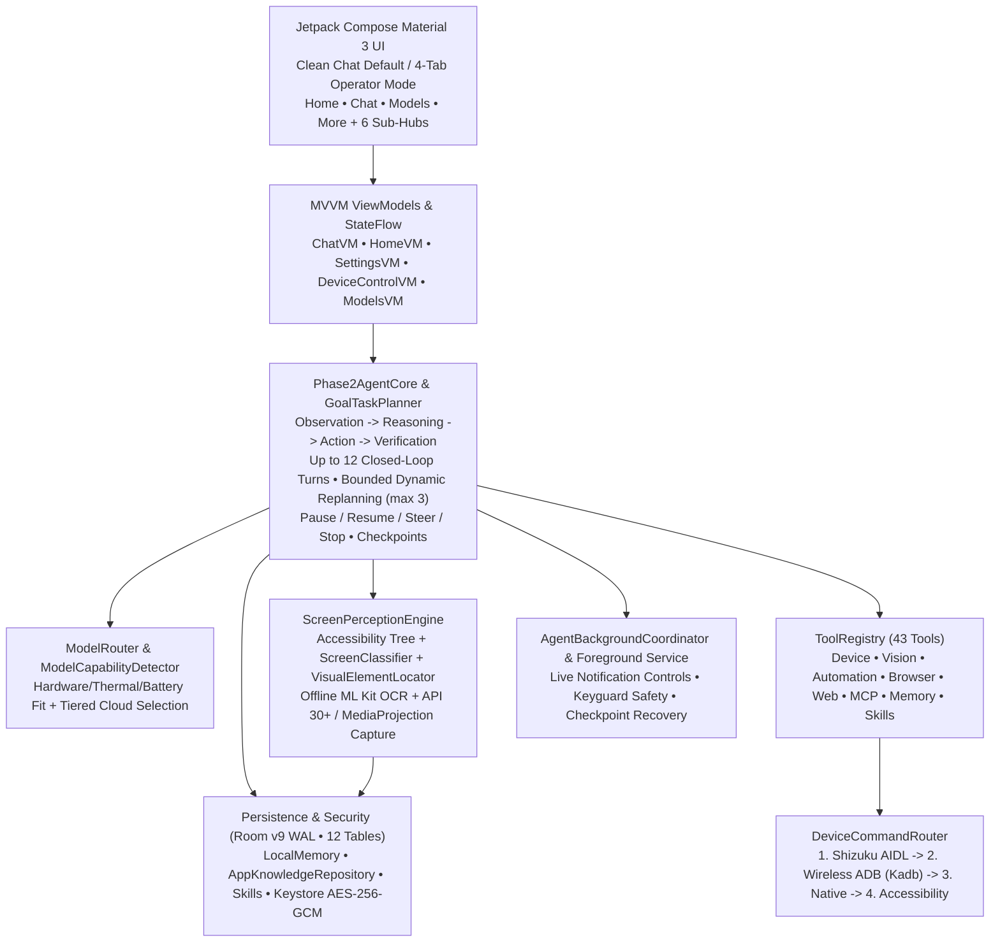

# J.A.R.V.I.S Android — System Architecture Reference (v1.0.2)

## 1. Architectural Overview
**J.A.R.V.I.S** (`v1.0.2`, `versionCode = 3`, `com.aistudio.jarvis.k8v4mz`, `GPL-3.0`) is a local-first, autonomous hybrid Android AI agent built in Kotlin and Jetpack Compose (`Material 3`), targeting Android 7.0 through Android 16 (`minSdk 24`, `compileSdk 36`, `targetSdk 36`).

---

## 2. Autonomous Agent Core (`core/agent/`, `core/background/`)
- **Goal-Oriented Multi-Step Planning (`GoalTaskPlanner`):** Decomposes composite user goals (such as finding media in a third-party app, extracting content, summarizing it, and saving to memory, or opening/navigating a web workflow) into verifiable `MEMORY_LOOKUP -> ANDROID_TOOL -> CONTEXT_OBSERVE -> AI_SYNTHESIS -> RESULT_VERIFY` pipelines.
- **Closed-Loop Control (`Phase2AgentCore`):** Runs up to 12 bounded turns with explicit `AgentExecutionPhase` states (`IDLE`, `THINKING`, `OBSERVING`, `EXECUTING`, `WAITING_PERMISSION`, `WAITING_CONFIRMATION`, `VERIFYING`, `PAUSED`, `RECOVERING`, `COMPLETED`, `FAILED`, `CANCELLED`), structured `AgentTimelineEntry` logs, `ScreenJournal` stagnation/oscillation `[RECOVERY_SIGNAL]` detection, and bounded dynamic replanning (maximum 3 replans per run).
- **Transparent Background Execution (`AgentBackgroundCoordinator`, `AgentExecutionForegroundService`):** Manages foreground execution with persistent **Pause / Resume / Stop** notification actions, keyguard lock-state safety checks, interrupted checkpoint detection on restart, and `VirtualDisplayFeasibilityProbe` (honest Android 12–16 sandbox assessment).

---

## 3. Unified Device Control & Automation Engine (`core/device/`, `core/automation/`, `aidl/`)
- **Priority-Based Routing (`DeviceCommandRouter`):**
  1. **Shizuku (`ShizukuController` + `RealShizukuGateway` + `JarvisShizukuUserService`):** Uses `dev.rikka.shizuku:api/provider:13.1.5` and `IJarvisShizukuService.aidl`, tracking binder lifecycle, permission requests/denials, and distinguishing root (`uid=0`) vs ADB shell (`uid=2000`).
  2. **Pure-Kotlin Wireless ADB (`WirelessAdbController` + `KadbWirelessTransport`):** Uses `com.flyfishxu:kadb:1.3.0` (Android 11+ SPAKE2 + TLS 1.3) and `NsdManager` mDNS port discovery, validating sessions via a live `id` probe and scrubbing 6-digit pairing codes immediately.
  3. **Native Android (`AndroidNativeController`):** Standard Android intents, battery/memory/network telemetry, audio/media, and contacts APIs.
  4. **Accessibility Fallback (`AccessibilityController` + `JarvisAccessibilityService`):** Opt-in UI hierarchy inspection, semantic/coordinate tapping, scrolling, swiping, text entry, global navigation, and API 30+ `takeScreenshot()`.
- **Unified Automation Engine (`AndroidAutomationEngine`, `AutomationTools`):** Adds wait-for-screen stabilization (`wait_for_screen`), hybrid Accessibility + OCR visual tap localization (`locate_and_tap_visual`), and structured device navigation (`navigate_device`).
- **Allowlisted Operations (`PrivilegedActionId`, `AllowlistedCommandValidator`):** Arbitrary shell execution is blocked; `FORCE_STOP_APP` rejects protected system, bridge, and JARVIS packages.

---

## 4. Screen Perception, Browser Automation & MCP (`core/vision/`, `core/browser/`, `core/mcp/`, `core/web/`)
- **Screen Perception (`ScreenPerceptionEngine`, `ScreenClassifier`, `VisualElementLocator`):** Combines depth-first Accessibility hierarchy compression (`ScreenTreeCompressor`, password `[REDACTED_PASSWORD]` masking), screen state classification (`LOADING`, `DIALOG_PERMISSION`, `SEARCH`, `FEED_LIST`, `MEDIA_PLAYER`, `FORM_INPUT`, `BROWSER`, `SETTINGS`, `SENSITIVE_BLOCKED`), offline **ML Kit OCR (`16.0.1`)**, API 30+ / `MediaProjection` fallback capture, LRU frame caching, and context-aware cloud image attachment (`shouldAttachScreenshotToCloud`).
- **Browser Automation (`BrowserAutomationEngine`, `BrowserTools`):** Stateful multi-tab HTTP/HTML browser engine with backstack navigation, link clicking, GET/POST form submission, JSON-LD extraction, and mandatory SSRF protection (`PublicHttpSafetyGuard`) blocking loopback, RFC-1918 LAN, link-local / cloud metadata (`169.254.169.254`), CGNAT, and IPv6 ULA ranges across requests and redirects.
- **MCP Client (`McpClient`, `McpManager`):** Streamable HTTP & SSE JSON-RPC 2.0 (`initialize`, `notifications/initialized`, `tools/list`, `tools/call`, `Mcp-Session-Id`) with Room `mcp_servers` persistence and confirmation gates for write/mutating tools.

---

## 5. Multi-Provider AI & Local LiteRT-LM Runtime (`core/ai/`, `core/model/`, `core/cloud/`)
- **On-Device Runtime (`RuntimeFormatAdapter`, `ModelCompatibilityEngine`):**
  - `LiteRtLmFormatAdapter` (`.litertlm`): Supported natively via `LiteRtLmAiEngine` (`0.10.2`) off the UI thread (`Dispatchers.IO`) with `GPU -> CPU` fallback.
  - Unbundled formats (`GGUF`, `TFLite`, `MediaPipe .task`, `Safetensors`) explicitly report `isExecutionSupported = false` and are never mocked.
- **Capability-Aware Cloud & Hybrid Routing (`ModelRouter`, `ModelCapabilityDetector`, `PromptCompressor`):** Detects model tool/vision/structured-output support across Gemini, OpenAI-compatible, OpenRouter, and Anthropic endpoints; selects fast/balanced/reasoning/vision tiers; respects RAM (`<= 85%`), thermal, and battery budgets; and compacts older turns into factual digests.

---

## 6. Registered Tools (43 Tools in `ToolRegistryFactory`)
- **App & System (`8`):** `launch_installed_app`, `open_app_screen`, `go_home_screen`, `open_android_settings`, `read_battery_status`, `read_device_info`, `adjust_media_volume`, `control_media_playback`
- **Privileged Bridge (`3`):** `check_device_bridge`, `force_stop_app` *(HIGH, confirmed)*, `trim_app_caches` *(MEDIUM, confirmed)*
- **Communications & Reminders (`4`):** `search_contacts`, `initiate_phone_call` *(HIGH, confirmed)*, `compose_message` *(HIGH, confirmed)*, `create_reminder` *(HIGH, confirmed)*
- **Notifications & Accessibility (`6`):** `read_notifications`, `accessibility_global_action`, `inspect_screen_elements`, `tap_ui_element`, `scroll_screen`, `input_ui_text`
- **Phone-Use Vision & Gestures (`5`):** `capture_screen_ocr`, `capture_screen_visual` *(HIGH, confirmed)*, `tap_coordinates` *(HIGH, confirmed)*, `long_press_coordinates` *(HIGH, confirmed)*, `swipe_screen` *(HIGH, confirmed)*
- **Autonomous Navigation (`3`):** `wait_for_screen`, `locate_and_tap_visual`, `navigate_device`
- **Browser Automation (`6`):** `browser_open`, `browser_read`, `browser_click_link`, `browser_fill_form`, `browser_back`, `browser_tabs`
- **Web Research & MCP (`4`):** `open_url`, `web_search`, `fetch_webpage`, `mcp_call`
- **Memory & Procedural Skills (`4`):** `retrieve_memory`, `save_memory`, `save_skill`, `run_skill`

---

## 7. Design System & Persistence (`ui/`, `data/local/db/`)
- **Visual Design System (`ui/theme/DesignTokens.kt`, `ui/components/JarvisDesignSystem.kt`, `AgentActivityComponents.kt`):** Deep Graphite (`#0E1015` / `#151922`) & Light Alabaster (`#F4F6F9` / `#FFFFFF`) palettes with cyan-blue accents, bundled **Space Grotesk / Plus Jakarta Sans / JetBrains Mono** typography, `JarvisGlassCard`, `JarvisStatusIndicator`, memoized `JarvisMarkdownText`, live `AgentPhaseBadge`, `ScreenObservationPreviewCard`, `AgentLiveTimelineSection`, and `AgentStopSummaryBanner`.
- **Room Database v9 (`JarvisDatabase`):** WAL mode with deterministic migrations `1 → 9` (`MIGRATION_8_9`) across **12 tables**:
  `conversations`, `messages`, `model_entries`, `download_queue`, `model_benchmarks`, `memory_notes`, `agent_executions`, `agent_skills`, `agent_checkpoints`, `research_history`, `mcp_servers`, `app_knowledge`.
- **Security Controls (`core/security/`):** Android Keystore AES-256-GCM (`SecureCredentialStore`), `AppBlocklistPolicy`, `ScreenRiskClassifier`, `PromptSecuritySanitizer`, `SecurityLogRedactor`, and `HttpSecuritySupport` redirect auth stripping.
